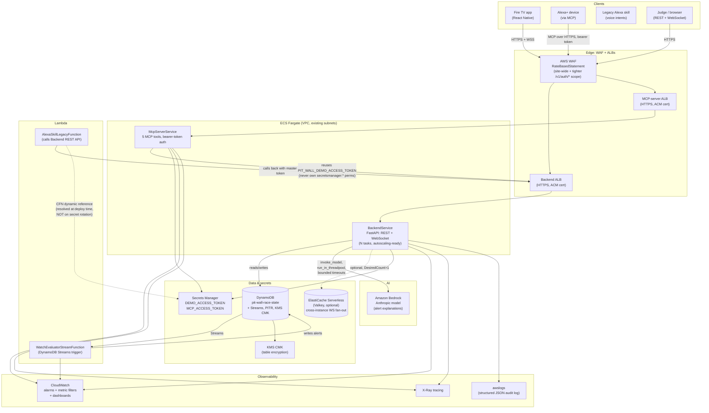

# AWS Architecture — Pit Wall Copilot

> **Honest status**: this document describes `infrastructure/template.yaml`
> as it exists in this repository, which has been schema-validated
> (`cfn-lint`, `sam validate`) and `sam build`-tested for both Lambda
> functions, but **has not been deployed against a real AWS account** —
> there is no AWS access in this development environment. See
> `docs/deployment-runbook.md` for the exact deploy steps and
> `REMAINING_EXTERNAL_VERIFICATION.md` for everything that genuinely
> requires a real account to verify. Every claim below is a claim about
> what the template/code *defines*, not a claim that it has been
> observed running in production.

## One-paragraph summary

Pit Wall Copilot is a real-time race-strategy assistant: a Python/FastAPI
backend simulates or ingests race state, evaluates strategy "watches"
(e.g. undercut windows) against that state, and pushes alerts to a Fire TV
app over a WebSocket, with an Alexa+ voice surface reaching the same data
through an MCP (Model Context Protocol) server. All of it deploys as one
CloudFormation/SAM template: two ECS Fargate services (backend,
mcp_server) behind Application Load Balancers, a DynamoDB table (with
Streams) as the single source of truth for race/watch/alert/pairing state,
two Lambda functions (a Streams-triggered watch evaluator, and a legacy
Alexa skill adapter), Amazon Bedrock for LLM-generated alert explanations,
and the supporting security/observability layer (WAF, Secrets Manager,
KMS, CloudWatch alarms, X-Ray).

## Architecture diagram

## Components

| Component | AWS resource(s) | Role |
|---|---|---|
| Backend API | ECS Fargate `BackendService` behind `BackendLoadBalancer` | FastAPI: race state, strategy simulation, watches/alerts, device pairing, `/v1/races/{id}/ws` (auth'd WebSocket), `explain` (Bedrock-backed) |
| MCP server | ECS Fargate `McpServerService` behind `McpLoadBalancer` | Exposes 5 MCP tools over `/mcp` for Alexa+; bearer-token-authenticated (`PIT_WALL_MCP_ACCESS_TOKEN`), calls the backend's own REST API internally, no direct DynamoDB access |
| State store | `RaceStateTable` (DynamoDB) | Single-table design: race state, watches, alerts, pairing codes/device tokens, active-run generation locks. Streams enabled, PITR on, SSE-KMS with a customer-managed key, `DeletionPolicy: Retain` |
| Watch evaluation | `WatchEvaluatorStreamFunction` (Lambda, DynamoDB Streams trigger) | Reuses the same `WatchEvaluator` the in-process backend calls, so a scaled-out deployment's watch evaluation stays correct even if the producing ECS task differs from the one that would otherwise have run it in-process |
| Legacy Alexa skill | `AlexaSkillLegacyFunction` (Lambda) | Classic Alexa Skills Kit intent handler; calls the backend's REST API with the master `DEMO_ACCESS_TOKEN` |
| LLM explanations | Amazon Bedrock (`BedrockLLMClient`, `LLM_PROVIDER=bedrock`) | Turns grounded strategy facts into a spoken-style explanation; the backend's `ExplanationEngine` independently re-checks every number the model returns against the grounded facts (an LLM can phrase, never invent a number) |
| Edge security | `RateLimitWebAcl` (WAF), ACM-terminated HTTPS on both ALBs | Two-tier rate limiting: a tighter `RateBasedStatement` scoped to `/v1/auth/*` (pairing is the most abuse-sensitive surface), and a looser site-wide rule |
| Secrets | `DemoAccessTokenSecret`, `McpAccessTokenSecret` (Secrets Manager) | Generated by Secrets Manager itself at stack-create time; never rendered in plaintext in the template, a parameter, or CloudTrail |
| Encryption | `RaceStateTableKey` (customer-managed KMS key) | Scopes key usage to this account/service via `kms:CallerAccount`/`kms:ViaService` conditions |
| Cross-instance realtime | `EventBrokerCache` (ElastiCache Serverless, Valkey) — optional, `EnableCrossInstanceEventBroker` | Redis pub/sub fan-out so a WebSocket client connected to ECS task A still receives an event produced by task B (see ADR 0001) |
| Observability | CloudWatch alarms + metric filters (throttling, pairing failures, unhealthy hosts, DynamoDB errors), X-Ray tracing, structured JSON audit logging to `awslogs` | See `docs/observability-runbook.md` / CloudWatch dashboard (Phase 4) |

## Request flows

**Judge/Fire TV reads race state**: client → WAF → Backend ALB →
`BackendService` → DynamoDB (`GetItem`/`Query`) → response. No Bedrock
call on this path.

**Fire TV opens the live WebSocket**: client → WAF → Backend ALB →
`BackendService`'s `/v1/races/{race_id}/ws?token=...` — the token is the
same `X-Demo-Access-Token` credential every HTTP request sends (a paired
device token, or the master token), checked before `websocket.accept()`
via `credential_is_valid` (`app/api/deps.py`); an invalid/missing token
gets the connection closed with code 4401 and never receives any race
data. See `docs/adr/0002-websocket-query-token-authentication.md`.

**Strategy alert explanation (Bedrock path)**: client → Backend ALB →
`BackendService`'s `GET /v1/races/{id}/alerts/{id}/explain` → the actual
`invoke_model` call runs via `starlette.concurrency.run_in_threadpool`
(so a slow/blocked Bedrock call cannot freeze the event loop for every
other concurrent request or open WebSocket on that task) with bounded
`connect_timeout=5s`/`read_timeout=15s` and `max_attempts=2` on the boto3
client — a hung Bedrock call now fails fast and predictably instead of
tying up a worker thread indefinitely.

**Watch alert generation**: a race-state write to `RaceStateTable`
triggers DynamoDB Streams → `WatchEvaluatorStreamFunction` → evaluates
every active watch against the new state → writes any new alert back to
DynamoDB → the backend's own state-commit hook broadcasts a `WATCH_ALERT`
event over the WebSocket (and, if `EVENT_BROKER=redis`, fans it out to
every other ECS task's own locally-connected clients too).

**Alexa+ query**: device → Alexa+ platform → MCP protocol over HTTPS →
WAF → MCP ALB → `McpServerService` (bearer-token-authenticated) → calls
the backend's own REST API with the master `X-Demo-Access-Token` → same
DynamoDB-backed state the Fire TV app reads.

**Legacy Alexa skill**: device → Alexa Skills Kit → `AlexaSkillLegacyFunction`
(Lambda) → calls the backend's REST API with `PIT_WALL_DEMO_ACCESS_TOKEN`,
which CloudFormation resolves from Secrets Manager **once, at stack-deploy
time** via a dynamic reference — this is why rotating `DEMO_ACCESS_TOKEN`
requires a stack re-deploy for this one Lambda to pick up the new value
(see "Secret rotation" in `docs/deployment-runbook.md`).

## Security architecture summary

- **AuthN/AuthZ**: every mutating REST endpoint and the WebSocket route
  require `X-Demo-Access-Token` (a master token or a live paired-device
  token — `app/api/deps.py`'s `require_demo_access_token`/
  `credential_is_valid`); minting new pairing codes and administrative
  device revocation additionally require the master token specifically
  (`require_master_demo_access_token`) so a compromised device token
  cannot escalate to pairing arbitrary new devices.
- **Fail-closed by construction**: if no master token is configured at
  all in production, mutating endpoints return 503, never silently open
  (`validate_production_configuration`, checked at startup).
- **Transport**: HTTPS/WSS end-to-end when `CertificateArn` is supplied
  (the required default); plaintext is only reachable via an explicit
  `AllowInsecureDemoHttp=true` opt-in, and the Fire TV client itself
  refuses to open a plaintext connection in a release build regardless of
  what the backend allows (`assertSecureTransportForRelease`).
- **Rate limiting**: layered WAF rules — a tight limit scoped to
  `/v1/auth/*` (pairing-code/pair/revoke), a looser site-wide limit
  underneath.
- **Secrets**: never in the template, a parameter, git, or a log line —
  generated by Secrets Manager, read via ECS `Secrets:` (container-start
  resolution) or a Lambda's Secrets Manager IAM permission scoped to the
  exact secret ARN (never `secretsmanager:*`).
- **Encryption at rest**: DynamoDB table encrypted with a customer-managed
  KMS key; Secrets Manager encrypts secrets by default.
- **Data-loss protection**: DynamoDB point-in-time recovery, `Retain`
  deletion policy on the table and its KMS key's replacement, on-demand
  backup documented as a manual option for pre-migration snapshots.
- **Audit logging**: every auth failure, pairing event, and device
  revocation is logged as one structured JSON line via `audit_log`, with
  a hard guard (`AuditFieldViolation`) that refuses to log any
  secret-shaped field name (`token`, `password`, `*_key`, etc.) — this is
  enforced by raising before the log call happens, not by best-effort
  redaction after the fact.
- **Least privilege IAM**: `BackendTaskRole`/`McpTaskRole`/Lambda roles
  each scope `secretsmanager:GetSecretValue` to the one secret ARN they
  actually need; `McpServerService` has no DynamoDB permissions at all
  (it only ever talks to the backend's own REST API).

## Reliability and scaling notes

- `BackendService` is designed to run with `DesiredCount > 1` — all
  durable state lives in DynamoDB, and cross-instance WebSocket delivery
  is handled by the optional Redis/Valkey event broker (ADR 0001). Raise
  `DesiredCount` only after setting `EnableCrossInstanceEventBroker=true`.
- CloudWatch alarms cover: DynamoDB throttling/system errors, unhealthy
  ALB targets, elevated pairing-code failures/throttling (a proxy for
  brute-force pairing attempts), and Lambda errors on the watch evaluator.
- X-Ray tracing is enabled on both ECS services and both Lambdas.
- See `docs/deployment-runbook.md`'s "Backup and restoration" section for
  the DynamoDB PITR/on-demand-backup procedure, and its new "Secret
  rotation" section for the manual token-rotation runbook (including the
  Lambda dynamic-reference gotcha above).

## Related documents

- `docs/deployment-runbook.md` — step-by-step deploy, pairing, backup,
  and secret-rotation procedures.
- `docs/adr/0001-cross-instance-event-broker.md` — why/how WebSocket
  events fan out across ECS tasks.
- `docs/adr/0002-websocket-query-token-authentication.md` — why the
  WebSocket route authenticates via `?token=`, not a header.
- `docs/adr/0003-plain-asgi-request-body-size-limit.md` — why the
  request-body size limiter is a raw ASGI middleware, not
  `BaseHTTPMiddleware`.
- `REMAINING_EXTERNAL_VERIFICATION.md` — the honest list of everything
  that requires a real AWS account, real device, or real network access
  to verify, that this environment could not execute.
- `infrastructure/template.yaml` — the actual source of truth; this
  document is a reader's map of it, not a replacement for it.
