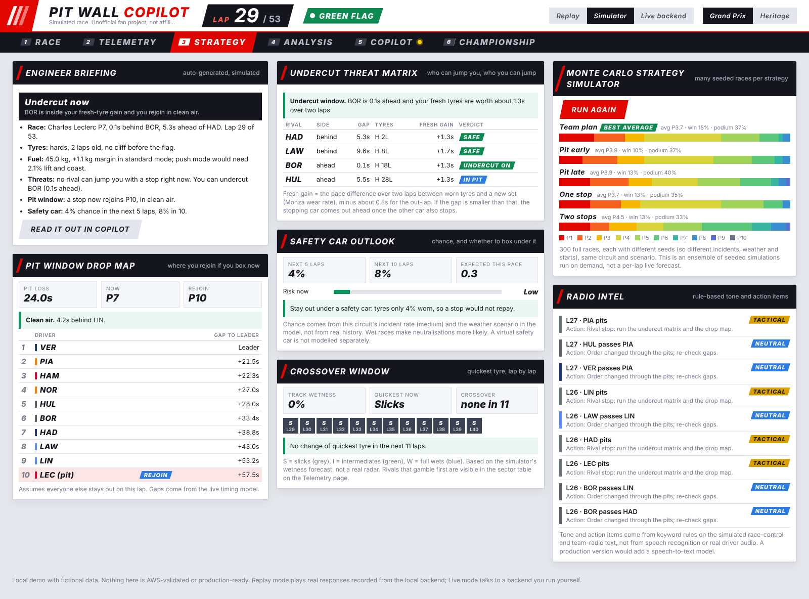
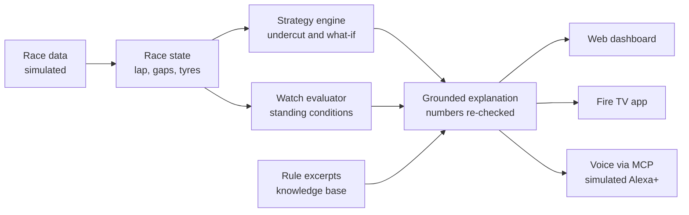
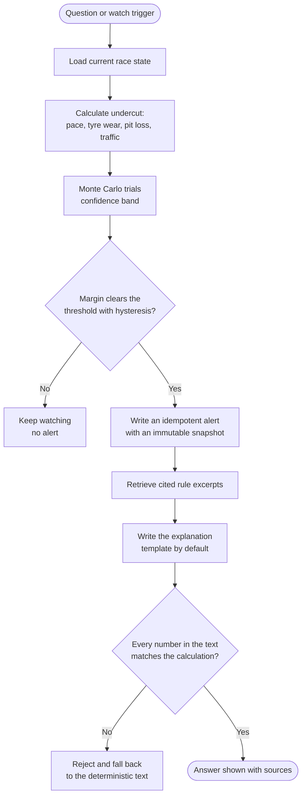
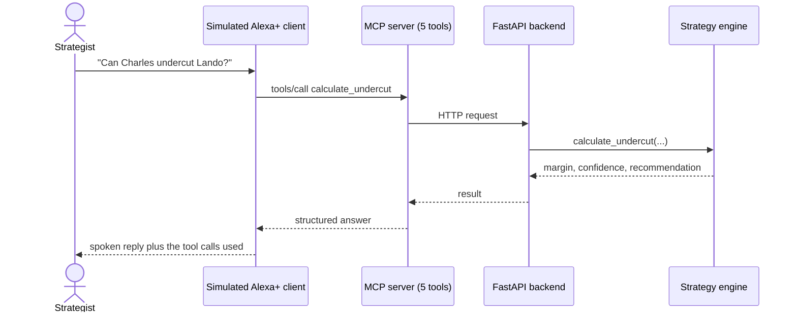
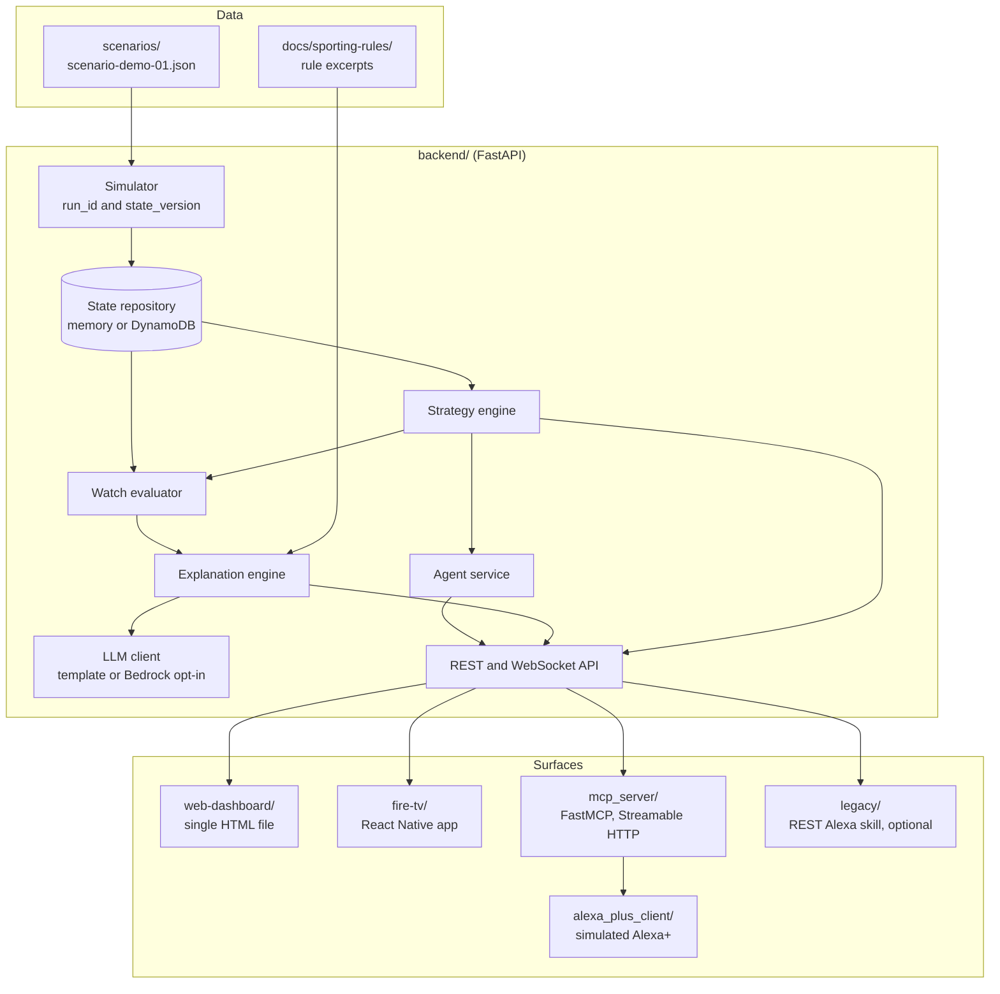
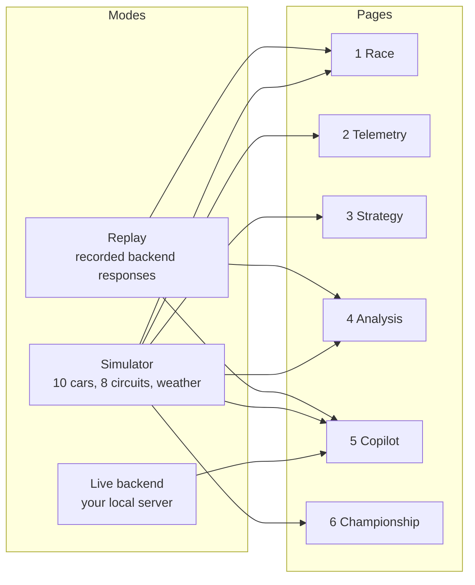
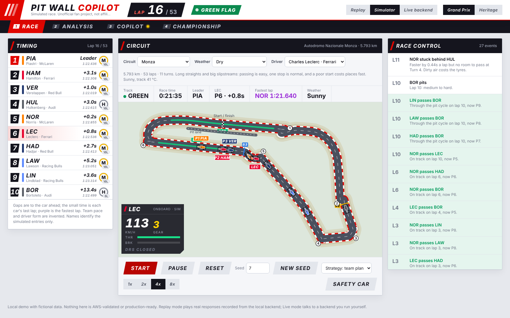
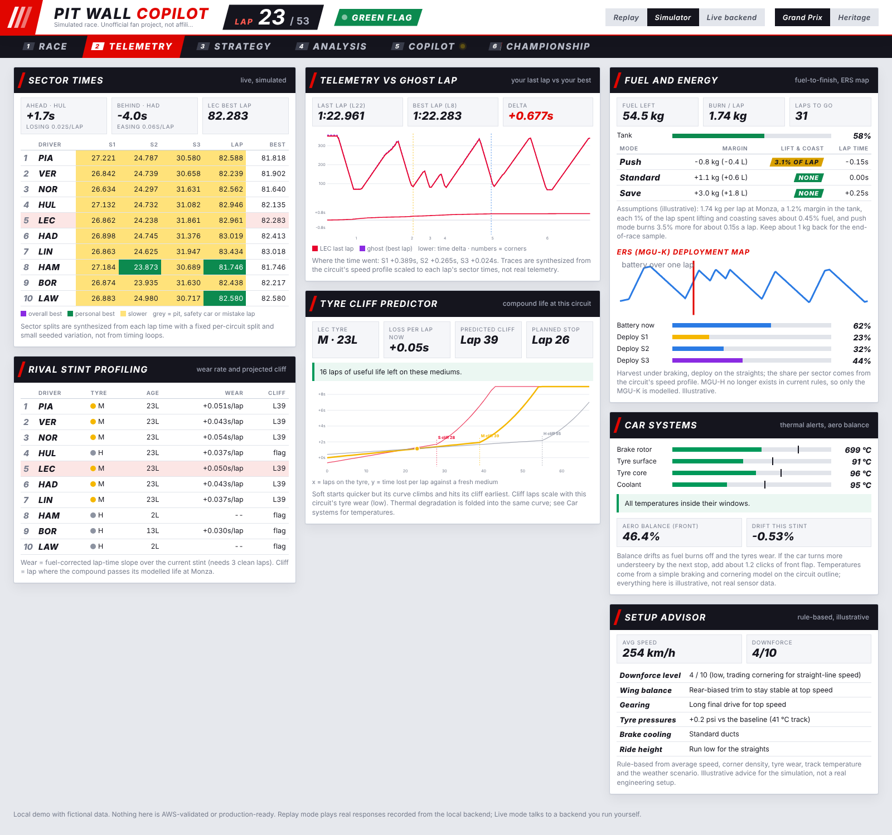
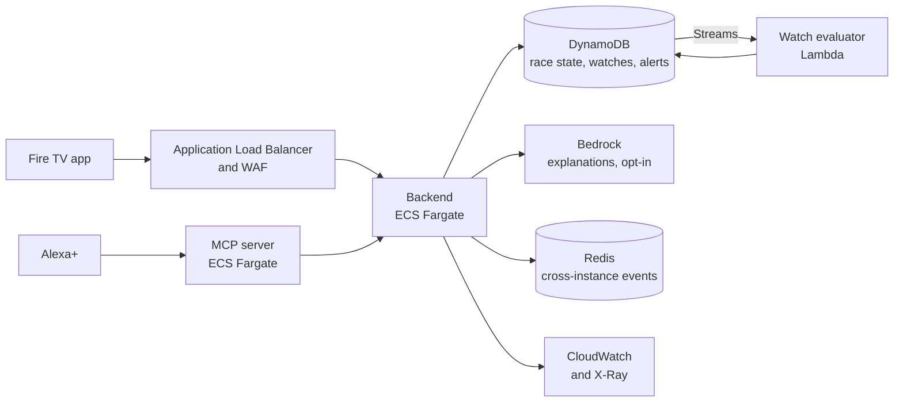

# Pit Wall Copilot

**An AI race-strategy companion for the pit wall: it watches the race, tells you when an undercut is on, and explains why, using calculations you can check rather than guesses.**

Built for the *Build, Ship, Shape: Amazon Developer Hackathon*. Runs fully on your own machine with no AWS account.

[](./LICENSE)




> **Honest status.** This is an unofficial fan project, not affiliated with Formula 1, the FIA or any team. Team and driver names and circuit shapes are real so the demo is recognisable; **every number, lap time, tyre model and result is simulated**. The backend and tests run locally. **Nothing has been deployed to or validated on AWS**, no real Bedrock endpoint is called, and no AWS credentials are used. The release name is `source-validated-aws-pending`. It is not production-ready.

---

## Contents

1. [What it does](#1-what-it-does)
2. [How a decision is made](#2-how-a-decision-is-made)
3. [Architecture](#3-architecture)
4. [The web dashboard](#4-the-web-dashboard)
5. [Quick start](#5-quick-start)
6. [Testing](#6-testing)
7. [Repository layout](#7-repository-layout)
8. [What is real, simulated, and not built](#8-what-is-real-simulated-and-not-built)
9. [AWS target design (not deployed)](#9-aws-target-design-not-deployed)
10. [Documentation index](#10-documentation-index)

---

## 1. What it does

In a race the strategist keeps asking the same question: *should we pit now to jump the car ahead, and what happens if we wait?* Pit Wall Copilot answers it in plain language and shows its working.

| You want to know | Pit Wall Copilot gives you |
|---|---|
| Is an undercut worth it? | A deterministic calculation of the time gained, with a Monte Carlo confidence band |
| PIT NOW or WAIT 3 LAPS? | A side-by-side simulation of both options |
| Tell me when it opens | A *strategy watch*: a standing condition checked every lap, with hysteresis so alerts do not flicker |
| Why now? | A written explanation whose numbers are re-checked against the calculation, with cited rule excerpts |
| Something it cannot know | A refusal, not an invented answer (for example a rule number that is not on file) |

You can reach it three ways: a **web dashboard** (broadcast-style, with engineering tools), a **Fire TV app**, and **voice** through an **MCP tool server** used by a simulated Alexa+ client.



---

## 2. How a decision is made

The model never decides the numbers. The strategy engine computes them, and the language layer only describes them.



A voice question follows the same path through MCP:



---

## 3. Architecture

One modular FastAPI backend holds all the logic. Every other surface is a thin adapter over its REST API, so the strategy code exists once.



Design choices worth knowing:

- **Deterministic first.** Undercut and what-if numbers come from the strategy engine. The explanation step may only restate them; a check rejects text whose numbers do not match.
- **Local by default.** `STATE_REPOSITORY=memory` and `LLM_PROVIDER=template` need nothing but Python. The DynamoDB and Bedrock paths exist behind switches and are tested with mocks only.
- **Safe controls.** Start, pause and reset need an access token. In local mode the backend prints a fresh random token at startup; no default token ships.
- **Live updates.** The backend pushes `RACE_STATE`, `STRATEGY_UPDATE` and `WATCH_ALERT` over a WebSocket; clients fall back to 2-second polling.

---

## 4. The web dashboard

`web-dashboard/index.html` is one file with no build step. Open it in a browser.



| Page | What is on it |
|---|---|
| **Race** | Timing tower, circuit map with DRS zones and numbered corners, start lights, onboard panel, race control |
| **Telemetry** (simulator) | Sector times and personal bests, live gaps, ghost lap, tyre cliff, fuel and energy, car temperatures, setup advisor |
| **Strategy** (simulator) | Engineer briefing, pit-window drop map, undercut threat matrix, safety-car outlook, crossover window, Monte Carlo, radio intel |
| **Analysis** | Weather and grip, tyre wear, lap chart and lap times |
| **Copilot** | Alexa+ (simulated) chat that shows the tool calls behind every answer |
| **Championship** (simulator) | Drivers' and constructors' standings over eight rounds |

Ten cars (Red Bull, Ferrari, McLaren, Audi, Racing Bulls) race on Monaco, Monza, Spa, Suzuka, Silverstone, Interlagos, Bahrain and Singapore outlines. Six weather scenarios change grip, lap times and safety-car odds. Two themes: Grand Prix (broadcast) and Heritage. Full details and screenshots are in [`web-dashboard/README.md`](./web-dashboard/README.md).

| Race | Telemetry |
|---|---|
|  |  |

---

## 5. Quick start

**You need:** Python 3.12, and a browser. Node.js 18+ only for the Fire TV app.

### a. Just look at it (no install)

Open `web-dashboard/index.html`. Replay mode plays the lap 24 to 28 scenario from responses recorded off the local backend. Switch to **Simulator** and press **Start** to run a full race.

### b. Run the backend and connect the dashboard

```bash
cd backend
python -m venv .venv && source .venv/bin/activate     # Windows: .venv\Scripts\Activate.ps1
pip install -r requirements.txt
cp ../.env.example .env

# in-memory state, template explanations, random token printed at startup
STATE_REPOSITORY=memory LLM_PROVIDER=template LOCAL_DEMO_AUTH_MODE=true \
  uvicorn app.main:app --port 8123
```

In another terminal:

```bash
cd web-dashboard && python -m http.server 8081
```

Open <http://localhost:8081>, choose **Live backend**, paste the token the backend printed, press **Connect**, then **Start**.

### c. Try the API

```bash
curl http://localhost:8123/health
curl http://localhost:8123/v1/races/demo-race-001/state
curl -X POST http://localhost:8123/v1/demo/start -H "X-Demo-Access-Token: <token>"
```

### d. Voice path (MCP and simulated Alexa+)

Each of `mcp_server/` and `alexa_plus_client/` has its own virtual environment. Their tests start a real backend and a real MCP server for you; see the README in each folder.

### Key settings

| Variable | Default | Meaning |
|---|---|---|
| `STATE_REPOSITORY` | `memory` | `memory`, or `dynamodb` (needs AWS, not used here) |
| `LLM_PROVIDER` | `template` | `template` is deterministic and offline; `bedrock` is opt-in and not used here |
| `LOCAL_DEMO_AUTH_MODE` | `false` | `true` prints a random token at startup (local use only) |
| `DEMO_ACCESS_TOKEN` | unset | Required for start, pause and reset when auth mode is off |
| `CORS_ALLOWED_ORIGINS` | local dev origins | Allow-list, never `*` |

The full list is in [`.env.example`](./.env.example).

---

## 6. Testing

| Suite | Where | How to run |
|---|---|---|
| Backend | `backend/tests/` | `cd backend && python -m pytest -q` |
| MCP server | `mcp_server/tests/` | `cd mcp_server && python -m pytest -q` |
| Simulated Alexa+ | `alexa_plus_client/tests/` | `cd alexa_plus_client && python -m pytest -q` |
| Legacy skill | `legacy/alexa_skill_legacy_rest/tests/` | `python -m pytest -q` in that folder |
| Fire TV app | `fire-tv/src/__tests__/` | `cd fire-tv && npm ci && npm test` |
| Demo, chaos, endurance | `scripts/` | see [`scripts/README.md`](./scripts/README.md) |

At the last run these all passed: 595 backend tests, 53 MCP server tests, 8 simulated Alexa+ tests, 19 legacy skill tests and 186 Fire TV tests (TypeScript type check included). The tests make no outbound AWS or network calls. Tests are never skipped or weakened to get a pass.

---

## 7. Repository layout

```text
pit-wall-copilot/
├── backend/            FastAPI app: simulator, strategy engine, watches, explanations, API
├── web-dashboard/      single-file browser dashboard and screenshots
├── fire-tv/            React Native app for Amazon Fire TV
├── mcp_server/         MCP tool server (5 tools) over Streamable HTTP
├── alexa_plus_client/  simulated Alexa+ client (primary voice path)
├── legacy/             optional REST-based Alexa skill (not the primary path)
├── scenarios/          the demo scenario (lap 24 to 28)
├── infrastructure/     SAM template and Lambda packaging, never deployed
├── scripts/            demo, chaos, endurance and release helper scripts
├── docs/               architecture, security, runbooks, ADRs, sporting-rule excerpts
├── docker-compose.yml  local convenience
└── .env.example
```

---

## 8. What is real, simulated, and not built

| Area | State |
|---|---|
| Strategy engine, watch evaluator, explanation checks, REST and WebSocket API | **Built and tested locally** |
| MCP server and simulated Alexa+ client (real MCP protocol, real HTTP) | **Built and tested locally** |
| Fire TV app source, with unit tests | **Built**; not run on a physical Fire TV, no signed APK |
| Web dashboard, simulator, engineer tools | **Built**; all numbers simulated |
| Race data, car pace, tyre and fuel models, weather | **Simulated** and illustrative |
| Radio intel | Keyword rules on simulated text; **no speech-to-text** |
| Alexa+ voice | **Simulated client only**; no real Alexa+ device or skill |
| DynamoDB, Bedrock, ECS, ALB, WAF, CloudWatch, X-Ray | **Code and templates exist; never deployed or validated** |
| Live telemetry (UDP, Kafka or Redis, FastF1) | **Roadmap only**: [`docs/TELEMETRY_ROADMAP.md`](./docs/TELEMETRY_ROADMAP.md) |

"Source-validated" means the code passes its local tests. It does not mean the product has been proven on AWS, on a real Fire TV or with a real voice assistant. The checklist for those steps is in [`docs/EXTERNAL_RELEASE_CHECKLIST.md`](./docs/EXTERNAL_RELEASE_CHECKLIST.md).

---

## 9. AWS target design (not deployed)

This is where the design would run if it were deployed. None of it has been created, and no AWS resource is touched by this repository.



Details, trade-offs and the unverified items are in [`docs/AWS_ARCHITECTURE.md`](./docs/AWS_ARCHITECTURE.md), [`docs/deployment-runbook.md`](./docs/deployment-runbook.md) and the [ADRs](./docs/adr).

---

## 10. Documentation index

| Document | Topic |
|---|---|
| [`web-dashboard/README.md`](./web-dashboard/README.md) | Dashboard modes, pages, feature table, screenshots |
| [`docs/AWS_ARCHITECTURE.md`](./docs/AWS_ARCHITECTURE.md) | Target AWS design |
| [`docs/TELEMETRY_ROADMAP.md`](./docs/TELEMETRY_ROADMAP.md) | Real-time telemetry proposal (not built) |
| [`docs/THREAT_MODEL.md`](./docs/THREAT_MODEL.md) and [`SECURITY.md`](./SECURITY.md) | Security model and policy |
| [`docs/DEPLOYMENT.md`](./docs/DEPLOYMENT.md), [`docs/deployment-runbook.md`](./docs/deployment-runbook.md), [`docs/OPERATIONS_RUNBOOK.md`](./docs/OPERATIONS_RUNBOOK.md), [`docs/observability-runbook.md`](./docs/observability-runbook.md) | Deployment and operations |
| [`docs/EXTERNAL_RELEASE_CHECKLIST.md`](./docs/EXTERNAL_RELEASE_CHECKLIST.md), [`docs/REMAINING_EXTERNAL_VERIFICATION.md`](./docs/REMAINING_EXTERNAL_VERIFICATION.md) | What still needs real AWS, a device or a signed build |
| [`docs/JUDGE_DEMO.md`](./docs/JUDGE_DEMO.md) and [`docs/JUDGE_QA.md`](./docs/JUDGE_QA.md) | Three-minute demo script and likely questions |
| [`docs/adr/`](./docs/adr) | Architecture decision records |
| [`docs/archive/`](./docs/archive) | The earlier, gate-by-gate README, kept for history |

## License and notices

MIT, see [`LICENSE`](./LICENSE). Circuit outlines are simplified from the open [f1-circuits](https://github.com/bacinger/f1-circuits) data, derived from OpenStreetMap contributors (ODbL). No official Formula 1 logos or fonts are used.
