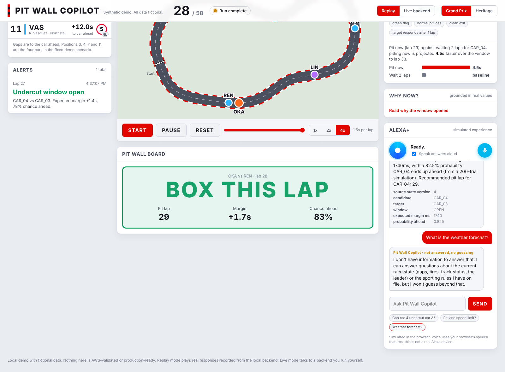
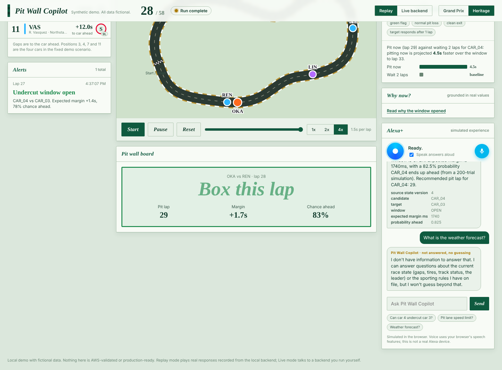

# Pit Wall Copilot web dashboard

A single-file browser dashboard (`index.html`, no build step) for the local demo. Fictional data only; not AWS-validated or production-ready.

- **Themes:** Grand Prix (bright F1.com-style white, red and navy) and Heritage (classic racing green and brass, light). Switch in the top bar.
- **Alexa+ panel (simulated):** type, tap a phrase or use the mic (browser speech recognition where supported); answers can be spoken aloud, and a proactive notification fires when the undercut window opens. Not a real Alexa device.
- **Replay mode (default):** plays the lap 24 to 28 scenario using real responses recorded from the local backend (state, undercut calculation, alert, explanation, pit-lane regulation, a safe refusal). Works by opening `index.html` directly. Start, Pause, Reset, speed and a scrubber are available.
- **Live backend mode:** talks to a backend you run yourself.
  1. `cd backend && STATE_REPOSITORY=memory LLM_PROVIDER=template LOCAL_DEMO_AUTH_MODE=true uvicorn app.main:app --port 8123` (it prints a demo token).
  2. `cd web-dashboard && python -m http.server 8081` (port 8081 is an allowed CORS origin).
  3. Open http://localhost:8081, choose Live backend, paste the token, Connect, then Start.

Car spacing on the circuit comes from the real `gap_to_leader_ms` values; the circuit outline is fictional. The pit-lane rule shows the text on file and states that no number is given.

