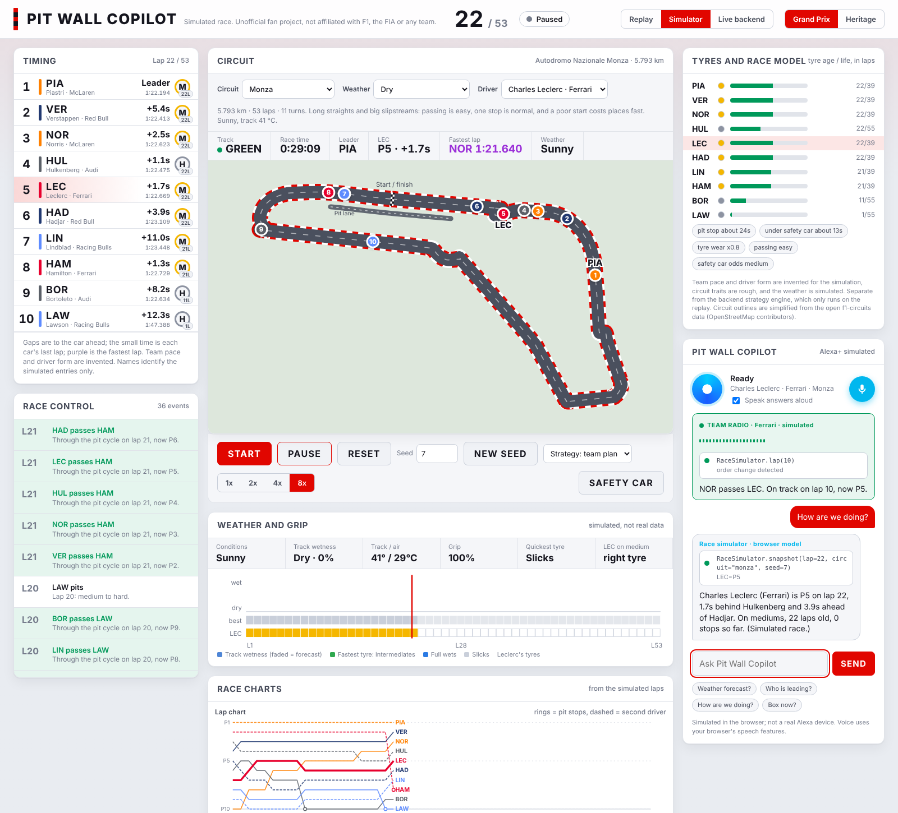
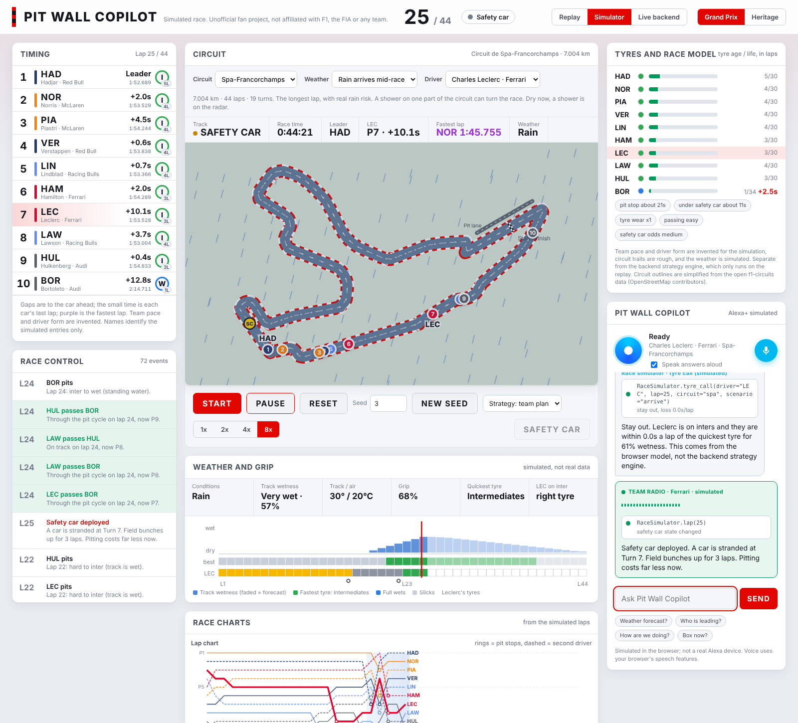
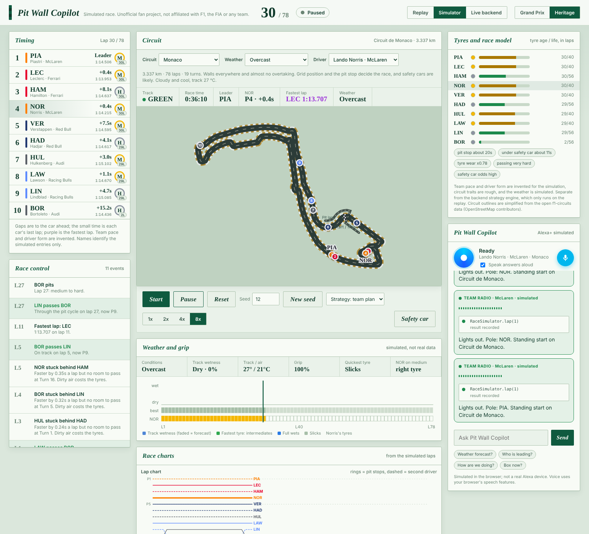
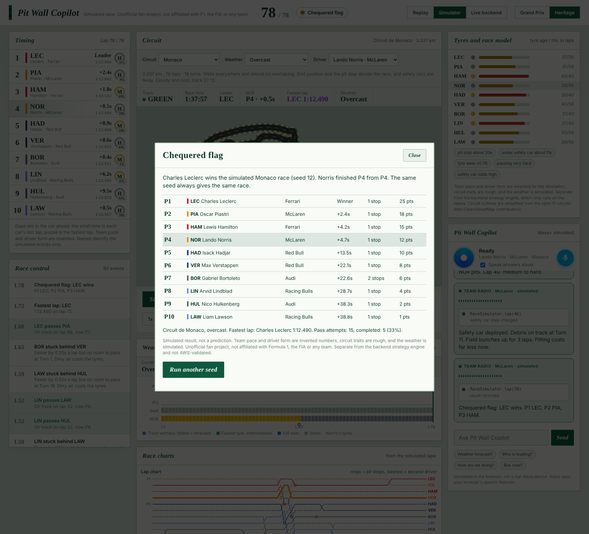
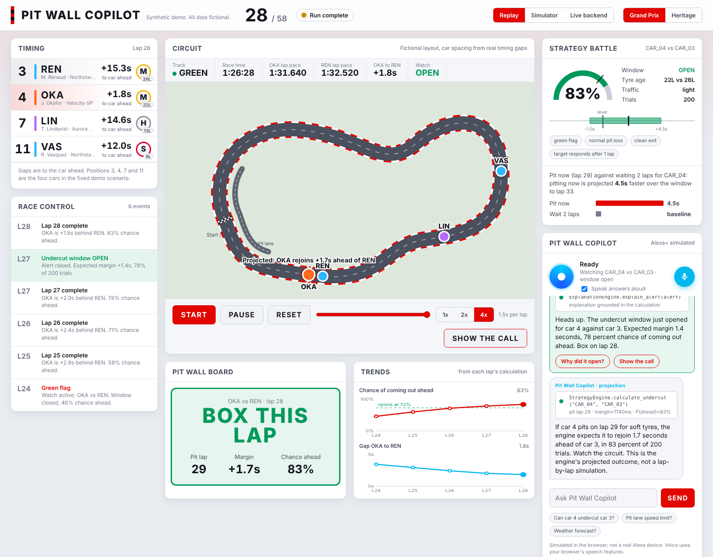
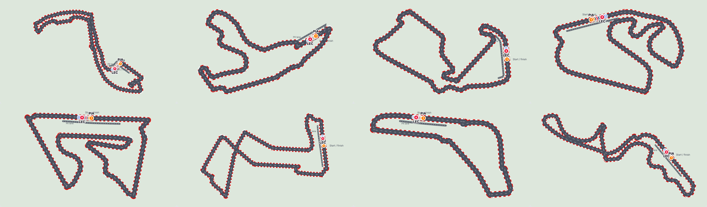

# Pit Wall Copilot web dashboard

A single-file browser dashboard (`index.html`, no build step) for the local demo. Fictional data only; not AWS-validated or production-ready.

- **Themes:** Grand Prix (bright F1.com-style white, red and navy) and Heritage (classic racing green and brass, light). Switch in the top bar.
- **Copilot panel (Alexa+ simulated):** answers stream in with a visible tool-call trace (the real engine, agent and regulation calls behind each answer), a team-radio style proactive alert when the window opens, and a "Show the call" pit-lane animation of the engine's projected outcome. Also: live telemetry strip, probability and gap trend charts, and a race-control feed.
- **Race simulator (browser model):** a full lap-by-lap race for 10 cars (Red Bull, Ferrari, McLaren, Audi and Racing Bulls, two drivers each) on eight real circuit layouts: Monaco, Monza, Spa-Francorchamps, Suzuka, Silverstone, Interlagos, Bahrain and Singapore. You pick the circuit, the weather and your driver, then watch a standing start, tyre wear and cliff, fuel burn, dirty air, pit stops, overtaking odds, mistakes, safety cars and the points table at the flag. Each circuit behaves differently (race length, pit-stop cost, how hard it is to pass, tyre wear, incident odds, lap time). Strategy buttons let you pit early or late, or force one or two stops, and the copilot answers questions about the race from the simulated state. Browser model, separate from the backend strategy engine; not AWS-validated.
- **Weather (simulator):** six scenarios (Dry, Overcast, Light rain, Heavy rain, Rain arrives mid-race, Drying track) change wetness, grip, lap times, mistakes and safety-car odds, and add intermediate and full-wet tyres with a crossover model. Teams choose when to switch with their own appetite for risk, so the field splits. A weather card shows conditions, a timeline (wetness, fastest tyre per lap, your driver's tyres), and the copilot answers "Weather forecast?" and "Box now?" from the simulated state. The weather is simulated, not a real forecast; in replay mode the copilot still declines weather questions because the backend has no weather data.
- **Voice:** type, tap a phrase or use the mic (browser speech recognition where supported); answers can be spoken aloud, and a proactive notification fires when the undercut window opens. Not a real Alexa device.
- **Replay mode (default):** plays the lap 24 to 28 scenario using real responses recorded from the local backend (state, undercut calculation, alert, explanation, pit-lane regulation, a safe refusal). Works by opening `index.html` directly. Start, Pause, Reset, speed and a scrubber are available.
- **Live backend mode:** talks to a backend you run yourself.
  1. `cd backend && STATE_REPOSITORY=memory LLM_PROVIDER=template LOCAL_DEMO_AUTH_MODE=true uvicorn app.main:app --port 8123` (it prints a demo token).
  2. `cd web-dashboard && python -m http.server 8081` (port 8081 is an allowed CORS origin).
  3. Open http://localhost:8081, choose Live backend, paste the token, Connect, then Start.

Car spacing on the circuit comes from the real `gap_to_leader_ms` values; the circuit outline is fictional. The pit-lane rule shows the text on file and states that no number is given.

## Real names, simulated numbers

The simulator uses the 2026 team and driver names and the layouts of real circuits so the demo is recognisable. Everything else is invented: team pace, driver form, tyre and pit-stop numbers, circuit traits and the weather are rough illustrative values, and every result is a simulation, not a prediction. This is an unofficial fan project, not affiliated with or endorsed by Formula 1, the FIA or any team, and it uses no logos. Replay mode keeps the recorded fictional drivers because those are what the backend produced.

Circuit outlines are simplified from the open [f1-circuits](https://github.com/bacinger/f1-circuits) GeoJSON data, which is derived from OpenStreetMap contributors' data (ODbL). Start-line positions and pit-lane drawings are approximate.

